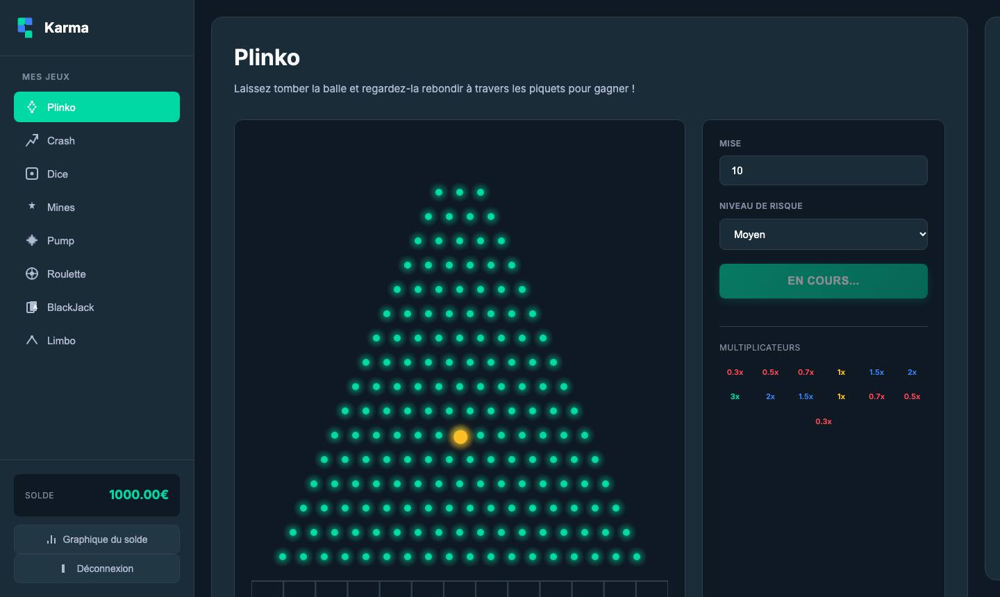
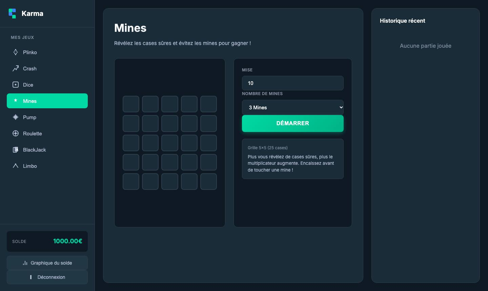
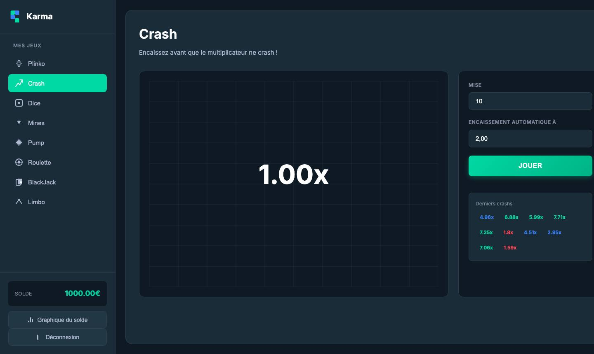

# Karma

Un **casino de démonstration** dans le navigateur, inspiré de Stake, avec **8 mini-jeux** et un solde qui évolue au fil des parties.

> 💡 **Tout est fictif** : chaque compte reçoit 1 000 € virtuels à l'inscription. Il n'y a aucun vrai argent, ni dépôt ni retrait. C'est un projet pour apprendre à coder une appli web complète : comptes, base de données, API et animations.

| Plinko | Mines | Crash |
|---|---|---|
|  |  |  |

## Les jeux

| Jeu | Principe |
|---|---|
| **Plinko** | une bille tombe à travers des piquets. Trois niveaux de risque changent les multiplicateurs. |
| **Crash** | un multiplicateur monte. Il faut encaisser avant qu'il « crashe ». |
| **Dice** | tu choisis un seuil et paries au-dessus ou en dessous. |
| **Mines** | grille 5 × 5 : révèle les cases sûres sans tomber sur une mine, puis encaisse. |
| **Pump** | gonfle le ballon, sans le faire éclater. |
| **Roulette** | la roulette classique. |
| **Blackjack** | contre la banque. |
| **Limbo** | vise un multiplicateur cible. |

En plus des jeux, il y a :
- un historique des parties ;
- un graphique du solde ;
- un système de connexion et d'inscription.

## Lancer en local

```bash
pip install -r requirements.txt
python app.py
```

Ouvre ensuite http://localhost:5000 et crée un compte.

**Base de données :** sans configuration, c'est un fichier SQLite (`instance/casino.db`). En ligne, l'appli utilise PostgreSQL via la variable `DATABASE_URL`.

## Technique

- **Back-end :** Python, avec Flask, Flask-SQLAlchemy et Werkzeug (mots de passe hachés).
- **Front-end :** HTML, CSS et JavaScript, avec un fichier par jeu dans `static/js/`.
- **Résultats :** ils sont calculés **côté serveur**, via les routes `POST /api/play/<jeu>`, et c'est aussi le serveur qui met à jour le solde. Le navigateur ne fait qu'afficher les animations.
- **Déploiement :** `render.yaml` crée le site et une base PostgreSQL gratuite sur Render. `SECRET_KEY` est générée automatiquement.

## À savoir

- `static/js/chicken.js` (un jeu « Chicken ») existe, mais n'est pas encore relié au menu.
- `limbo.js`, à la racine du dépôt, est une copie de `static/js/limbo.js`.
